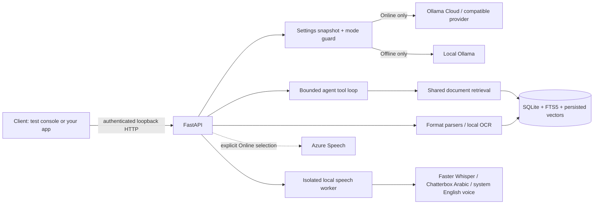

# Architecture and data flow

The process that starts the backend owns the session token. `backend/launcher.py` binds a random loopback port (or `EMS_PORT`) and reads the token from `EMS_SESSION_TOKEN`. `scripts/test_console.py` binds a fixed loopback port, creates a fresh token, and passes it to the browser in the URL fragment, which browsers never send to a server. The console's static page is mounted outside the API's token check and contains no data. Provider keys are never returned to any client.

The backend announces readiness only after FastAPI startup completes. Every API endpoint requires the session token. On Windows both launchers attach child processes to a kill-on-close job. Mac shutdown tracks EMS-owned descendants. Stopping the core releases the speech workers and private Ollama it owns. Existing external Ollama instances are never terminated by EMS.

## State and inference

`Settings.snapshot()` returns a deep copy. A conversation turn routes through that immutable snapshot. Mode changes are rejected while a response runs. Only a user-triggered settings mutation writes a new mode. Network checks and model failures cannot call that mutation. Cloud connection failures are labelled as an unreachable provider, since one failed request cannot prove that all internet connectivity is lost. HTTP 401/403 is authentication/permission failure, 404 is model/endpoint failure, 429 is rate limiting, and 5xx is provider failure.

Local inference validates a loopback Ollama endpoint and rejects cloud model tags and aliases whose `/api/show` metadata identifies a remote model. The private runtime also sets `OLLAMA_NO_CLOUD=1`. Web search is blocked for offline answers. Voice has an independent explicit mode: its offline mode blocks Azure; its online mode can use the online answer provider and optional Azure speech. Local embedding requests are likewise restricted to resident loopback models. A user-triggered model download is an explicit setup operation, separate from offline inference.

## Agent and retrieval

The model can call only registered, schema-validated tools: document search, representative library overview, arithmetic, and optional Brave search. Tools cannot execute shell commands, access arbitrary paths, browse arbitrary URLs, or send messages. The orchestrator permits at most four tool rounds and bounds tool execution time and result context. Model reasoning fields are not displayed. Visible answer text streams to the UI.

Each upload receives a SHA-256 digest. Unchanged files reuse the existing document ID and index. Extraction produces located passages; chunking respects paragraph/table-row boundaries and overlaps long passages. BGE-M3 embeddings are stored in SQLite alongside FTS5 text. Search combines keyword and vector ranks using reciprocal-rank fusion, then limits passages and characters sent to the model. This reranks candidates without an additional large reranker model. A missing embedding service produces a `keyword_only` status; cross-language retrieval then needs semantic indexing or model-directed translated queries.

Sources have stable IDs such as `[D42]`, a filename and location. Unknown IDs are removed from the final display rather than crashing Arabic answers. Citation existence is validated; factual correctness still requires grounding evaluation. An overview is explicitly representative and is not presented as a complete audit of every page.

## Storage and concurrency

One SQLite database stores chats, messages, documents, text chunks and vectors. WAL and short transactions support reading while ingesting. One ingestion queue limits memory use; embeddings are batched and persisted as each batch succeeds. Retry can fill missing vectors without re-extracting a successfully parsed file. One active conversational generation keeps a laptop from overloading. Query embeddings use a bounded in-memory cache; document content is not repeatedly sent wholesale.

Settings use atomic file replacement. Credentials use an encrypted DPAPI file on Windows and a workspace-scoped Keychain service on Mac; the settings API returns only configured/not-configured status. Cloud document sharing defaults off. Earlier answers derived from local documents are omitted from online history when sharing is off. A source-controlled `.env.example` lists credential names; only development loads an ignored `.env`.

The core is a per-user service, not an authenticated multi-user server. Do not expose the backend to a LAN or use the same operating-system account as a tenant-isolation boundary. Supporting teams requires a separate authentication and authorization design.
